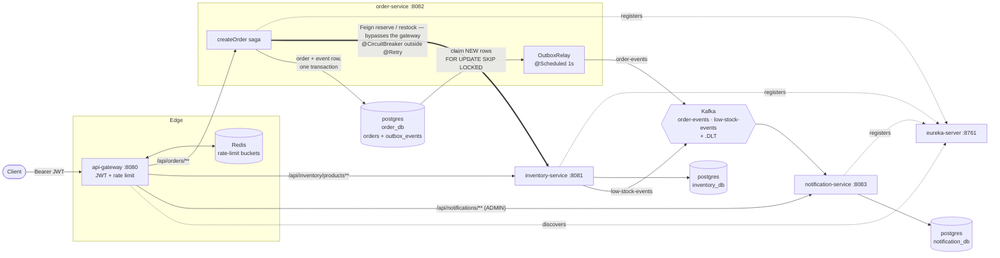

[](https://github.com/Jyoti-Yadav26/IMS-V2/actions/workflows/ci.yml)

# IMS — Inventory Management System

Microservices (Java 17, Spring Boot 3.2.5) that place orders against live inventory and survive the
failure modes a demo normally hides: a dependency that is down, a broker that is down, a double-clicked
button, and 500 customers racing for 100 units.

- `inventory-service` owns products, stock and prices
- `order-service` runs the order saga: reserve each line item, compensate on failure, publish one event
- `notification-service` consumes those events and records exactly one notification per event
- `api-gateway` is the only public entry point: JWT authentication, role checks and per-caller rate limiting
- `eureka-server` is the registry; nothing addresses another service by host

## Architecture



| Module | Port | Database | Role |
|---|---|---|---|
| `eureka-server` | 8761 | – | Service registry |
| `api-gateway` | 8080 | – | Auth, routing by service name, rate limiting (Redis) |
| `inventory-service` | 8081 | `inventory_db` | Products, stock, prices, `/reserve`, `/restock`, `LowStockEvent` |
| `order-service` | 8082 | `order_db` | Order saga, outbox, `OrderEvent` |
| `notification-service` | 8083 | `notification_db` | Kafka listeners, `Notification` rows, DLT routing |

Each service owns its database and nothing reads across a boundary. The DTOs and events shared between
services are **hand-duplicated copies**, not a shared library — manual sync in exchange for independent
deployability.

Two things in the diagram are deliberate. `order-service → inventory-service` goes straight over Feign
and Eureka, never through the gateway: `/api/inventory/reserve` is internal, is not matched by any
gateway route, and is denied by the gateway's security chain even for ADMIN. And the gateway talks to
Redis only for rate-limit buckets — no session, no token state.

**Who may call what** (enforced at the gateway only; the services themselves trust their caller):

| Endpoint | Required |
|---|---|
| `POST /auth/login` | public (demo issuer, see below) |
| `GET /api/inventory/products`, `/products/{sku}` | any valid token |
| `POST /api/inventory/products`, `POST /api/inventory/products/{sku}/restock` | `ADMIN` |
| `POST /api/orders`, `GET /api/orders/**` | any valid token |
| `GET /api/notifications` | `ADMIN` (rows are not user-scoped) |
| `/api/inventory/reserve` | denied, and not routed |
| `/actuator/**` on the gateway | denied except `/actuator/health` |

## Request flow

1. `POST /auth/login` returns an HS256 JWT (`accessToken`, 15 min).
2. `POST /api/orders` with that bearer token, and optionally an `Idempotency-Key` header. The gateway
   checks the token, strips any client-supplied `X-User-Id` / `X-User-Roles`, sets `X-User-Id` from the
   token subject, and spends one rate-limit token for that caller.
3. If the key was seen before, the stored order is returned and nothing is reserved again. A request
   repeating a SKU across two lines is rejected with 400 — the two lines would otherwise share one
   reservation key.
4. The order is saved `PENDING`, then each line item is reserved over Feign with the key
   `{orderNumber}-{itemIndex}`. **Inventory returns the price**; the request's `unitPrice` is ignored,
   and `totalAmount` is summed from what inventory charged.
5. Outcome: all items reserved → `CONFIRMED`. Inventory refused (no stock / unknown SKU) → `REJECTED`.
   Inventory unreachable, retries exhausted, circuit open, or a reserved line came back unpriced →
   `FAILED`. Either failure compensates first: every already-reserved line is restocked.
6. The event is written as an `outbox_events` row **in the order's transaction** — no broker call on the
   request thread. `POST /api/orders` answers `201` in all three cases; the outcome is in `status` and
   `failureReason`.
7. `OutboxRelay` wakes once a second, claims up to 100 `NEW` rows with `FOR UPDATE SKIP LOCKED`, sends
   each to Kafka keyed by order number, and marks it `SENT`.
8. `notification-service` consumes `order-events`, de-duplicates on the event's `eventId`, and writes
   one `Notification`.

## What changed from v1

| Issue in v1 | Fix in v2 | Test that proves it |
|---|---|---|
| Aspect order was `@Retry` outside `@CircuitBreaker`, so the inner fallback converted the first failure before retry could try again; a workaround then added `CallNotPermittedException` + `InventoryServiceUnavailableException` to retry's `ignore-exceptions`, silently killing all retries | `circuit-breaker-aspect-order: 1` / `retry-aspect-order: 2` — the breaker is the outer aspect, so an open circuit fails fast and retry gets all 3 attempts against the real downstream. `ignore-exceptions` is back to the two business exceptions, and `spring.cloud.openfeign.circuitbreaker.enabled: false` removes the second, redundant breaker | `InventoryResilienceIntegrationTest.inventoryError_retriesThreeTimesThenFails`, `.circuitOpen_failsFastWithZeroCalls` |
| `reserveStockFallback(.., Throwable)` swallowed business exceptions, so an over-order ended `FAILED` instead of `REJECTED` — listing an exception under `ignore-exceptions` keeps it out of the breaker's statistics but does **not** stop the fallback firing | The fallback rethrows `InsufficientStockException` / `ProductNotFoundException` unchanged | `InventoryResilienceIntegrationTest.insufficientStock_rejectsWithExactlyOneCall` |
| `JsonSerializer` stamped the producer's class name into `__TypeId__`; notification-service trusts only its own package, so **every** event failed type resolution and went straight to `<topic>.DLT`. Not one notification was ever saved | Producers publish a logical token (`order-event`, `low-stock-event`) via `TYPE_MAPPINGS`; the consumer maps those tokens to its own records, with `TRUSTED_PACKAGES` as a backstop. The token is the wire contract, the class names behind it stay private to each service | `OrderEventKafkaTypeMappingIntegrationTest.orderEventWithMappedTypeToken_isPersistedAsNotification` and `.orderEventWithRawClassNameHeader_isRoutedToDeadLetterTopic` |
| The same SKU twice in one order produced the same reservation key, so the second line was replayed without decrementing — an oversell | Duplicate SKUs are rejected with 400; the reservation key became `orderNumber + "-" + itemIndex` | `OrderServiceImplTest.createOrder_rejectsDuplicateSkuInSameOrder`, `.createOrder_usesLineItemIndexAsReservationIdempotencyKey` |
| `restockFallback` swallowed failures, so compensation marked items `reserved=false` and logged "Compensated" even when the restock had failed | The fallback rethrows; the item stays `reserved=true` and the saga logs `COMPENSATION FAILED` with order, SKU and quantity | `InventoryResilienceIntegrationTest.restockFailure_compensationCallsOnlyOnce`, `OrderServiceImplTest.createOrder_leavesItemReservedWhenCompensatingRestockFails` |
| Malformed JSON and `@Min` violations returned 500; `order_items.order_id` had no index | `HttpMessageNotReadableException` and `ConstraintViolationException` handlers in both services return 400, and the generic 500 now logs the exception and returns a fixed message instead of leaking internals. `@Index(name = "idx_order_items_order_id")` on `OrderItem` | `OrderControllerErrorHandlingTest`, `ProductControllerErrorHandlingTest` — both cover the malformed body, the constraint violation and that a 500 leaks nothing |
| No idempotency on `POST /api/orders`: a double click placed two orders | Optional `Idempotency-Key` header, nullable+unique `orders.idempotency_key`, a pre-check in `createOrder`, and the concurrent duplicate resolved by `IdempotentOrderCreator` catching the constraint violation and returning the winner | `OrderIdempotencyIntegrationTest.sameIdempotencyKeyTwice_createsOneOrderAndReservesEachItemOnce`, `IdempotentOrderCreatorTest.create_returnsTheWinningOrderWhenAConcurrentRequestInsertedTheSameKey` |
| The Kafka send happened inside the order transaction, before commit, with failures only logged — a dual write | `OrderEventPublisher.publish` writes an `OutboxEvent` row in the order's transaction; `OutboxRelay` sends after commit, claiming rows with `FOR UPDATE SKIP LOCKED`; `OrderEvent` gained a durable `eventId` | `OutboxRelayPostgresKafkaIntegrationTest.anOrderPlacedWhileKafkaIsDown_isStillPlacedAndItsEventIsDeliveredOnceKafkaIsBack`, `OutboxRelayTest`, `OrderEventPublisherTest` |
| The notification consumer was not idempotent, so an at-least-once redelivery emailed the customer twice | Nullable+unique `notifications.event_id`; `NotificationService.send` skips on `existsByEventId` and swallows a concurrent `23505` on that constraint. `LowStockEvent` also carries an `eventId` now | `OrderEventIdempotentConsumerIntegrationTest.theSameOrderEventDeliveredTwice_createsExactlyOneNotification`, `NotificationServiceTest.send_whenAConcurrentDuplicateTripsTheUniqueConstraint_treatsItAsAlreadyDone` |
| Docker Engine 29 made the container tests report as *skipped*, which looks exactly like Docker not running | A one-line `src/test/resources/docker-java.properties` pinning `api.version=1.44` in the three modules that use Testcontainers | The suite runs those classes instead of skipping them — see "Docker Engine 29" below |
| Concurrency and idempotency were asserted on H2, where they pass while production oversells | Real-Postgres integration tests: 20 threads racing for one unit, and one idempotency key sent both sequentially and simultaneously | `StockReservationConcurrencyIntegrationTest`, `StockReservationIdempotencyIntegrationTest` |
| The order total came from the request body, so a client could price its own order | `StockReservationResponse` carries `unitPrice` from `Product.price`; `OrderItem.unitPrice` and `Order.totalAmount` are built from inventory's answer, and a replayed reservation returns the price as of the reservation rather than today's | `OrderServiceImplTest.createOrder_ignoresClientUnitPriceAndUsesInventoryPrice`, `StockReservationIdempotencyIntegrationTest.aReplayedKey_returnsThePriceAsOfTheReservationEvenAfterTheProductIsRepriced` |
| Every endpoint was public and unmetered | Gateway-only HS256 JWT (WebFlux resource server) with role rules, `X-User-Id` asserted from the token after stripping the client's, and a Redis `RequestRateLimiter` keyed on user then IP | `GatewayAuthIntegrationTest` (roles, expiry, bad signature, spoofed headers, `/reserve` denied even for ADMIN, actuator locked down), `GatewayRateLimitIntegrationTest`, `GatewayRateLimiterFailOpenIntegrationTest` |
| Nothing exercised the system at flash-sale concurrency | `ims_load_test.py flash`: 500 concurrent orders against 100 units, asserting `CONFIRMED + final stock == starting stock` and that stock never goes negative. It surfaced orders coming back as HTTP 500 instead of a `FAILED` body — the two Resilience4j fallbacks were `private` and are now package-private | `ims_load_test.py flash`. **No JVM test pins that visibility**: `InventoryResilienceIntegrationTest` passes with the fallbacks private too (measured) |
| No automated build | GitHub Actions on push and PR to `main`: JDK 17, `mvn -B clean verify`, surefire reports uploaded on failure. Docker is available on the runner, so the container tests really run | the badge at the top |

## Guarantees

| Guarantee | Mechanism | Test |
|---|---|---|
| **No oversell** | `@Version` optimistic locking on `Product`, plus a bounded retry loop in `ProductServiceImpl` | `StockReservationConcurrencyIntegrationTest.twentySimultaneousReservationsOfOneUnit_sellItExactlyOnce` — 20 threads released together against 1 unit: exactly one `RESERVED`, the other 19 split between "insufficient stock" and "too much contention", both correct answers. Delete `@Version` and the test fails |
| **Idempotent order placement** | unique `orders.idempotency_key`, pre-check plus `IdempotentOrderCreator` for the race | `OrderIdempotencyIntegrationTest.sameIdempotencyKeyTwice_createsOneOrderAndReservesEachItemOnce`, `IdempotentOrderCreatorTest.create_returnsTheWinningOrderWhenAConcurrentRequestInsertedTheSameKey` |
| **Idempotent reservations** | a `stock_reservations` ledger keyed on the idempotency key; a replay returns the stored outcome and the stored price | `StockReservationIdempotencyIntegrationTest.theSameKeySentTwiceInSequence_decrementsStockOnce`, `.theSameKeySentTwiceAtOnce_stillDecrementsStockOnce` |
| **No lost events** | the event row and the order commit together; the relay sends afterwards and keeps the row `NEW` until Kafka acknowledges | `OutboxRelayPostgresKafkaIntegrationTest.anOrderPlacedWhileKafkaIsDown_isStillPlacedAndItsEventIsDeliveredOnceKafkaIsBack`, `OrderEventPublisherTest.publish_writesExactlyOneNewOutboxRowForTheOrder` |
| **No duplicate notifications** | a stable `eventId` per event, `existsByEventId`, and the unique `uk_notifications_event_id` behind it | `OrderEventIdempotentConsumerIntegrationTest.theSameOrderEventDeliveredTwice_createsExactlyOneNotification`, `NotificationServiceTest` (including the concurrent duplicate and a blank id) |

Delivery is at-least-once, not exactly-once, and deliberately so: the relay can crash after Kafka's ack
but before the row is marked `SENT`. The consumer's de-duplication is what turns that into "one
notification per event", which is why both halves exist.

## Failure scenarios

**inventory-service slow or down.** Each reserve gets 3 attempts with exponential backoff (300 ms base).
After 5 calls in a 10-call window with a 50% failure rate the breaker opens for 15 s, then probes with 3
calls. While it is open, calls fail immediately without entering the retry layer: the integration test
asserts `FAILED` in under 100 ms with **zero** downstream calls. The order is still recorded, with
`status=FAILED` and the reason — `POST /api/orders` never answers 503.

**Kafka down.** Nothing on the request thread touches the broker, so orders are placed normally and the
event sits `NEW` in `outbox_events`. The relay retries once a second, incrementing `attempts`, and stops
each batch at the first send failure to preserve per-order ordering. A row that can *never* be sent
(unknown `eventType`, unreadable payload) is logged, counted and skipped instead, so it cannot wedge the
queue behind it.

**A duplicate event.** The consumer sees an `eventId` it already has, logs "Skipping duplicate event" and
writes nothing. If two threads or replicas race past that check, the unique constraint decides and the
loser treats `23505` as proof the work is done, rather than letting it stall the partition for three
retries.

**A retry after a timeout where the first call actually succeeded.** The reservation key
(`{orderNumber}-{itemIndex}`) is already in the ledger, so inventory replays the stored outcome — and the
stored price — instead of decrementing again.

**Redis down.** Spring Cloud Gateway's `RequestRateLimiter` fails open: requests are still served,
unmetered, and authentication still applies. The Redis health indicator is switched off on purpose so a
Redis outage does not mark a working gateway `DOWN`. Covered by
`GatewayRateLimiterFailOpenIntegrationTest`, which points Lettuce at a closed port and needs no Docker.

**A compensating restock fails.** The item stays `reserved=true`, the saga logs
`COMPENSATION FAILED: order=… sku=… quantity=…` and carries on with the other lines, so the order row
records exactly what inventory still has decremented. `restock` deliberately has no `@Retry`: releasing
stock is not idempotent, so a retry after a lost response would release it twice.

## Known limitations

- **The services are published on their own ports** (8081/8082/8083) in `docker-compose.yml`, so anything
  on the host can skip the gateway and its auth entirely. Convenient for the load scripts and for reading
  `/actuator/health`; it means the authorisation story holds only for traffic arriving on 8080.
- **`/auth/login` is not rate limited.** It is a controller on the gateway, not a route, so the
  `default-filters` limiter never sees it. No lockout, no captcha.
- **No token revocation.** A leaked token stays valid until it expires (15 min). There is no refresh token
  either.
- **HS256 with a shared secret**, and the gateway is both issuer and verifier. Production would validate
  RS256 against an identity provider's JWKS (Keycloak or similar) so nothing but the IdP can mint a token.
  The two demo users are hard-coded in `application.yml`.
- **`createOrder` is still one transaction**, so the `PENDING` row is not committed before the remote
  calls: a crash mid-saga rolls the attempt back rather than leaving an auditable `PENDING` order. Known,
  and not fixed in v2 — fixing it properly means splitting the saga into separately committed steps.
- **Compensation is a restock call** that can itself fail. When it does, the drift is logged and visible
  on the order row, but nothing reconciles it automatically.
- **The `FAILED` notification text promises a retry that does not exist** ("We'll retry automatically").
  Nothing re-drives a `FAILED` order today.
- **One Kafka broker, and topics are auto-created** with the broker's default single partition, the
  `.DLT` topics included. There are no `NewTopic` beans and the listener containers run at concurrency 1,
  so consumer parallelism is capped at one per topic.
- **`OrderEvent` is duplicated** in `order-service` and `notification-service` with no contract test. The
  kebab-case type token is the only agreement between them; a field added on one side and forgotten on
  the other is caught by nothing.
- **`SENT` outbox rows are never deleted.** The table grows forever. The index on `(status, id)` keeps the
  relay's poll cheap, but a cleanup job is still missing.
- **`LowStockEvent` is published before commit**, from inside the reservation transaction, and its
  `eventId` is minted at send time rather than stored — so it is still a dual write, and an
  optimistic-lock retry can alert the admin twice. Deliberate: a duplicate internal alert did not justify
  a second outbox.
- **The container tests skip silently without Docker.** `mvn test` is then green while five classes — the
  ones that prove `SKIP LOCKED`, the `@Version` race, reservation idempotency, and the gateway's auth and
  rate limiting — never ran.
- **Nothing in `mvn test` pins the Resilience4j fallback visibility.** Making both fallbacks `private`
  again still leaves `InventoryResilienceIntegrationTest` green (verified), so only the flash script would
  catch that regression.

## Decisions, and what I'd change

- **Duplicated DTOs instead of a shared library.** Costs manual sync when a contract changes; buys
  genuine independent deployability. Worth revisiting once drift becomes a real bug source — a
  consumer-driven contract test is the cheaper half-step.
- **A hand-written saga instead of a distributed transaction.** Easier to reason about and debug than 2PC,
  but the compensation is written per failure mode and does not scale past a handful of steps. An
  orchestrator (or an outbox-driven saga) is the next move if the flow grows past "reserve N items, roll
  back on failure".
- **`POST /api/orders` always answers 201.** The right call — "we recorded your order" and "we can fulfil
  it" are different questions — but it obliges every client to read `status`, which is easy to forget. A
  webhook would let clients stop inspecting the body.
- **The gateway is a single instance.** Everything downstream is protected; the front door is not. If the
  gateway dies the platform is unreachable from outside, however healthy the three services are.
  Kubernetes is the planned fix — replicas behind a Service, readiness/liveness probes, and discovery via
  the Kubernetes API instead of Eureka — which is also where restart-on-crash and rolling deploys come
  from. None of that is needed to demonstrate the patterns here; it matters when the bar moves from
  "these patterns work" to "this holds production traffic".

## How to run

Requires Docker Desktop, plus JDK 17 and Maven for the tests.

```bash
docker compose up --build
```

That brings up Zookeeper, Kafka, three Postgres instances, Redis, Eureka, the gateway and the three
services. Eureka dashboard: <http://localhost:8761>. Everything else goes through
<http://localhost:8080>.

To iterate on one service locally:

```bash
docker compose up zookeeper kafka postgres-inventory postgres-order postgres-notification redis
mvn clean install -DskipTests
mvn spring-boot:run -pl eureka-server     # then api-gateway, inventory-service, order-service, notification-service
```

### Demo users

Two in-memory accounts, issued by the gateway's demo `POST /auth/login`. The passwords are BCrypt hashes
in `api-gateway/src/main/resources/application.yml`; override them with `CUSTOMER_PASSWORD_HASH` /
`ADMIN_PASSWORD_HASH` (double every `$` when passing a hash through compose).

| User | Password | Role |
|---|---|---|
| `customer1` | `customer-demo-pw` | `CUSTOMER` |
| `admin1` | `admin-demo-pw` | `ADMIN` |

`JWT_SECRET` must be at least 32 bytes — the gateway refuses to start otherwise. `docker-compose.yml`
carries a dev-only default; a real deployment injects it from a secret store.

### Try it

```bash
# 1. log in as the admin and keep the token
ADMIN=$(curl -s -X POST http://localhost:8080/auth/login \
  -H "Content-Type: application/json" \
  -d '{"username":"admin1","password":"admin-demo-pw"}' | sed -n 's/.*"accessToken":"\([^"]*\)".*/\1/p')

# 2. create a product (ADMIN only)
curl -X POST http://localhost:8080/api/inventory/products \
  -H "Authorization: Bearer $ADMIN" -H "Content-Type: application/json" \
  -d '{"sku":"SKU-100","name":"Wireless Mouse","price":19.99,"quantity":10,"reorderThreshold":3}'

# 3. log in as the customer and place an order
CUST=$(curl -s -X POST http://localhost:8080/auth/login \
  -H "Content-Type: application/json" \
  -d '{"username":"customer1","password":"customer-demo-pw"}' | sed -n 's/.*"accessToken":"\([^"]*\)".*/\1/p')

curl -X POST http://localhost:8080/api/orders \
  -H "Authorization: Bearer $CUST" -H "Content-Type: application/json" \
  -H "Idempotency-Key: demo-order-1" \
  -d '{"customerEmail":"buyer@example.com","items":[{"sku":"SKU-100","quantity":8}]}'
```

Repeat step 3 unchanged: the same order comes back and stock is still 2. Then stop `inventory-service`
and order again to watch the breaker open — `http://localhost:8082/actuator/health` reports its state.

> **Prices are not the caller's to set.** `unitPrice` is accepted in the request body so older clients
> keep working, and then ignored: posting `"unitPrice":0.01` for a 19.99 product still produces a 19.99
> order. Only a `CONFIRMED` order carries a total; `REJECTED` and `FAILED` are 0, because their stock was
> released and nothing is owed.

On Windows, PowerShell's quoting breaks the single-quoted JSON above — use `Invoke-RestMethod`:

```powershell
$admin = (Invoke-RestMethod -Method Post -Uri http://localhost:8080/auth/login `
  -ContentType "application/json" `
  -Body '{"username":"admin1","password":"admin-demo-pw"}').accessToken

Invoke-RestMethod -Method Post -Uri http://localhost:8080/api/inventory/products `
  -Headers @{ Authorization = "Bearer $admin" } -ContentType "application/json" `
  -Body '{"sku":"SKU-100","name":"Wireless Mouse","price":19.99,"quantity":10,"reorderThreshold":3}'
```

### Upgrading a database created before v2

The schema is managed by `ddl-auto: update`, which adds new columns and indexes but is **quietly
best-effort about unique constraints** — Hibernate's default strategy swallows the failure, so the service
can boot with the pre-check and nothing behind it. On a pre-existing volume, run these once (or just
`docker compose down -v` and start clean):

```sql
-- order_db
ALTER TABLE orders ADD COLUMN IF NOT EXISTS idempotency_key varchar(255);
ALTER TABLE orders ADD CONSTRAINT uk_orders_idempotency_key UNIQUE (idempotency_key);

-- notification_db
ALTER TABLE notifications ADD COLUMN IF NOT EXISTS event_id varchar(255);
ALTER TABLE notifications ADD CONSTRAINT uk_notifications_event_id UNIQUE (event_id);
```

`outbox_events` is a new table and is created outright, constraints included. `order_items.unit_price` and
`idx_order_items_order_id` are added by `ddl-auto` without help.

### Running the tests

```bash
mvn test                                 # whole suite
mvn verify                               # same tests, plus packaging — what CI runs
mvn -pl inventory-service test           # one module
mvn -pl order-service test -Dtest=OutboxRelayPostgresKafkaIntegrationTest
```

**Docker Desktop must be running.** Five classes start real containers, because what they verify is
database, broker and Redis behaviour rather than application logic — on H2 or an embedded fake they would
pass while production oversold:

| Test | Containers | What it pins down |
|---|---|---|
| `OutboxRelayPostgresKafkaIntegrationTest` (order) | Postgres 16, Kafka | `FOR UPDATE SKIP LOCKED`, which H2 cannot parse; an order placed while the broker is unreachable is still placed, and its event arrives once the broker is back |
| `StockReservationConcurrencyIntegrationTest` (inventory) | Postgres 16 | 20 callers race for 1 unit and exactly one wins — the `@Version` lock |
| `StockReservationIdempotencyIntegrationTest` (inventory) | Postgres 16 | one key decrements stock once, sequentially and simultaneously, and replays the price as of the reservation |
| `GatewayAuthIntegrationTest` (gateway) | Redis 7 | roles, expiry, bad signatures, spoofed `X-User-Id`, `/reserve` denied even for ADMIN, actuator locked down |
| `GatewayRateLimitIntegrationTest` (gateway) | Redis 7 | a caller over the limit gets 429 with the rate-limit headers, and each user has their own bucket |

Images match `docker-compose.yml` (`postgres:16-alpine`, `confluentinc/cp-kafka:7.5.3`, `redis:7-alpine`),
and Testcontainers' Ryuk sidecar removes them when the JVM exits. Without Docker these classes **skip**
rather than fail — see the limitation above. Everything else needs nothing external: Mockito unit tests,
`@WebMvcTest` slices, `@SpringBootTest` on H2, `@EmbeddedKafka` listener tests, the WireMock-backed
resilience tests, and the Redis-down fail-open test.

There is no failsafe plugin and no `*IT` naming — every test runs under surefire, so `mvn test` and
`mvn verify` run the same set, and `mvn test` starts containers too. That is the trade-off for having one
obvious way to run the suite.

#### Docker Engine 29: why `docker-java.properties` exists

`api-gateway`, `inventory-service` and `order-service` each carry a one-line
`src/test/resources/docker-java.properties` pinning `api.version=1.44`. Without it **no container
starts**, and the symptom is misleading: the tests report as *skipped*, which looks like Docker simply not
running. The Testcontainers version the Spring Boot 3.2.5 BOM manages (1.19.7) does not negotiate an API
version — `DockerClientProviderStrategy` falls back to a hard-coded `VERSION_1_32`, and Docker Engine 29
raised its *minimum* to 1.40, so `/v1.32/info` returns HTTP 400 and Testcontainers concludes there is no
Docker environment. 1.44 is the ceiling the shaded docker-java 3.3.6 knows. This is test-scoped
configuration rather than a dependency change, and it can be deleted once the managed Testcontainers
version moves past 1.19.x.

### Load and resilience scripts

Two Python scripts in the repo root drive the running stack from outside. They are not part of
`mvn test` — they need the whole system up, and they exist to produce numbers.

```bash
docker compose up --build          # in another terminal
pip install requests
```

| Command | What it proves |
|---|---|
| `python ims_load_test.py idempotency` | 10 concurrent `/reserve` calls sharing one key decrement stock once, not ten times |
| `python ims_load_test.py concurrency` | 20 orders race for 10 units; 10 end `CONFIRMED`, the rest `REJECTED`, stock lands at 0 |
| `python ims_load_test.py flash [n_orders] [starting_qty]` | 500 concurrent single-unit orders against 100 units. Reports `CONFIRMED` / `REJECTED` / `FAILED` / 429 and latency, and asserts `CONFIRMED + final stock == starting stock` with stock never negative. Exits non-zero if either assertion fails |
| `python ims_load_test.py circuit-breaker` | latency before and after the breaker opens (stop `inventory-service` first — see the docstring) |
| `python ims_cb_experiment.py --feign-cb false --run 1` | open-circuit latency, measured only while actuator reports the breaker strictly `OPEN`. Prints one JSON object; the runs collected so far are in `cb_experiment_results_v2.json`. Needs the `CB-VERIFY01` product to exist, which now takes an admin token to create |

**The scripts log themselves in**, since every gateway route needs a JWT: as `admin1` to create products,
as `customer1` to place orders. Override the credentials with `IMS_ADMIN_USER` / `IMS_ADMIN_PASSWORD` /
`IMS_CUSTOMER_USER` / `IMS_CUSTOMER_PASSWORD` if you changed the hashes.

**Raise the rate limit before `flash`.** The bucket is keyed on the caller and all 500 orders share one,
so at the default 20 req/s (burst 40) roughly 440 come back `429` without ever reaching order-service.
The run still passes its assertions — a throttled request never touched stock — but it stops being a test
of concurrent reservation. The gateway reads these as environment variables, so the container has to be
recreated for a change to apply:

```powershell
$env:RATE_LIMIT_REPLENISH_RATE=2000; $env:RATE_LIMIT_BURST_CAPACITY=4000
docker compose up -d --force-recreate api-gateway
```

```bash
RATE_LIMIT_REPLENISH_RATE=2000 RATE_LIMIT_BURST_CAPACITY=4000 \
  docker compose up -d --force-recreate api-gateway
```

Drop the variables and recreate the gateway again to put the production-ish limit back. Leaving it at
20/s and watching the `429` count climb is a useful demo in its own right — just not at the same time as
the oversell test.

**Two calls deliberately skip the gateway**, both on `localhost:8081`: `reserve_stock_direct` (the gateway
neither routes nor permits `/api/inventory/reserve`, which is the internal saga endpoint order-service
reaches over Feign) and `get_stock`, which reads the stock the assertions are made against. A measurement
must not be able to fail because the burst it just fired emptied its own rate-limit bucket.

## Results

Filled in from real runs. Paste the raw script output under the table rather than summarising it.

| Date | Mode | Orders | Stock | CONFIRMED | REJECTED | FAILED | 429 | Final stock | Assertions | Notes |
|---|---|---|---|---|---|---|---|---|---|---|
|  | flash |  |  |  |  |  |  |  |  |  |
|  | concurrency |  |  |  |  |  |  |  |  |  |
|  | idempotency |  |  |  |  |  |  |  |  |  |

```text
(paste the `python ims_load_test.py flash` output here)
```

Open-circuit latency runs live in `cb_experiment_results_v2.json` (and the older
`cb_experiment_results.json`, whose key names predate the current script).

## Where to get help

- Open a GitHub issue on this repo.
- `GET /actuator/health` on `order-service` (8082) shows live circuit-breaker state. `health,info,metrics`
  are exposed on the business services; only `health` on the gateway.
- Each service's package layout (`controller` / `service` / `repository` / `client` / `event` /
  `exception`) maps 1:1 to responsibility, so start in the package matching the symptom.
